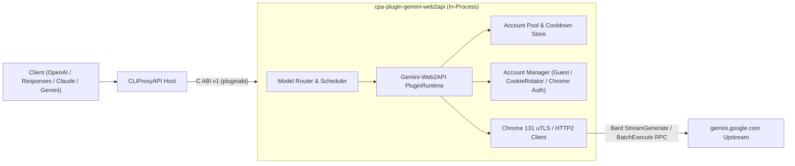

# cpa-plugin-gemini-web2api (Gemini-Web2API for CLIProxyAPI)

<p align="center">
  <a href="./README.md">简体中文</a> | <strong>English</strong>
</p>

<p align="center">
  <a href="https://github.com/Mag1cFall/Gemini-Web2API"></a>
  <a href="https://github.com/router-for-me/CLIProxyAPI"></a>
  <a href="./LICENSE"></a>
</p>

> **Upstream Attribution & Acknowledgements**  
> This repository is a native **[CLIProxyAPI](https://github.com/router-for-me/CLIProxyAPI)** dynamic-library plugin port (C ABI v1 / Schema v10) of **[Mag1cFall/Gemini-Web2API](https://github.com/Mag1cFall/Gemini-Web2API)**.  
> The core Google Gemini Web protocol stack (`gemini.google.com` Bard/StreamGenerate batch RPC, Chrome 131 TLS/HTTP2 fingerprint emulation, automatic Cookie rotation, keyless Guest sessions, multi-account load balancing, and multi-protocol translation) originates from **[Mag1cFall/Gemini-Web2API](https://github.com/Mag1cFall/Gemini-Web2API)** under the [MIT License](./LICENSE).

---

## Key Features

- **Pure Go Native Shared Library · Zero External Runtime Dependencies**: Uses `bogdanfinn/tls-client` to emulate Chrome 131 TLS/HTTP2 fingerprints directly inside the compiled shared library (`.dylib` / `.so` / `.dll`)—no Python, Node.js, Playwright, or headless browser required.
- **Full Google Gemini Web Model & Feature Coverage**:
  - **Core Chat & Reasoning Models**: `gemini-3.0-pro`, `gemini-3.0-flash`, `gemini-3.0-flash-thinking` (plus compatibility aliases `gemini-2.5-pro`, `gemini-2.5-flash`), with Thinking Level controls.
  - **Feature Variants & Multimodal**: `gemini-image` (image generation & editing), `gemini-video` (Veo video generation), `gemini-music` (Lyria music), `gemini-canvas`, `gemini-deep-research`, `gemini-learning`, `gemini-task`, and audio TTS/STT (`/v1/audio/*`).
- **Keyless Guest Session + Multi-Source Google Account Pool**:
  - Out-of-the-box **keyless Guest session** support;
  - **One-click isolated local Chrome login** and **Cookie / Playwright StorageState import**;
  - Built-in background Cookie rotation (`RotateCookies`).
- **Native 4-Protocol Input/Output**: Accepts and streams `chat-completions` (OpenAI Chat), `responses` (OpenAI Responses), `anthropic` (Claude Messages), and `gemini` (Google Gemini Native) formats.
- **Complete CLIProxyAPI Plugin Capabilities (All 9 Interfaces)**:
  1. `auth_provider`: Supports clicking **"Start Login"** directly in the ECPA / CPA OAuth dashboard (`auth.login_start` / `auth.login_poll`) to launch an isolated local Chrome window and auto-capture credentials, syncing 1-to-1 with `~/.cli-proxy-api/gemini-web2api-<id>.json`.
  2. `model_provider`: Static + per-credential dynamic discovery of Gemini Web models and capabilities (1M context window).
  3. `model_router`: Routes prefixed (`gemini-web/<model>`), custom `model_mapping` aliases, and unprefixed model requests.
  4. `scheduler`: Delegates to Gemini-Web2API's `AccountPool` (`round-robin` and `fill-first`), per-account concurrency limits, and per-model cooldown tracking.
  5. `executor`: Synchronous & streaming generation, client tool bridging (XML / Native Function Calling), local SentencePiece token counting, and multimodal file uploads.
  6. `request_lifecycle_plugin`: Tracks request completion and upstream status codes.
  7. `quota_provider`: Reports account subscription tiers (Free / Plus / Pro / Ultra), status, and per-model cooldown recovery timers in the CPA dashboard with one-click reset.
  8. `command_line_plugin`: Adds `--gemini-web2api-status` and `--gemini-web2api-login` CLI flags.
  9. `management_api` + Embedded Web Console (`/v0/resource/plugins/gemini-web2api/accounts`): Service start/stop toggle, Guest session toggle/relaunch, local isolated Chrome login, Cookie/StorageState account import, cooldown management, and live logs.

---

## Architecture



---

## Installation

### Option 1: Install from CLIProxyAPI Plugin Store (Recommended)
Open the CLIProxyAPI Management Center (or EasyCLIProxyAPI desktop app), navigate to **Plugins -> Store**, search for **`Gemini-Web2API`** (`gemini-web2api`), and click **Install**.

### Option 2: Download Prebuilt Binary from GitHub Releases
1. Download the archive for your platform from [Releases](https://github.com/jianli9158/cpa-plugin-gemini-web2api/releases):
   - macOS Apple Silicon: `gemini-web2api_1.0.0_darwin_arm64.zip`
   - macOS Intel: `gemini-web2api_1.0.0_darwin_amd64.zip`
   - Linux x86_64: `gemini-web2api_1.0.0_linux_amd64.zip`
   - Linux ARM64: `gemini-web2api_1.0.0_linux_arm64.zip`
   - Windows x86_64: `gemini-web2api_1.0.0_windows_amd64.zip`
2. Extract the dynamic library (`gemini-web2api.dylib` / `gemini-web2api.so` / `gemini-web2api.dll`) into CLIProxyAPI's plugin directory:
   ```text
   plugins/<goos>/<goarch>/gemini-web2api.{dylib,so,dll}
   ```

### Option 3: Build from Source
#### Prerequisites
- Go 1.26+ with `CGO_ENABLED=1`
- C compiler (macOS: Xcode Command Line Tools; Linux: GCC/Clang; Windows: MinGW-w64 / LLVM-MinGW)

#### Build Commands
```bash
git clone https://github.com/jianli9158/cpa-plugin-gemini-web2api.git
cd cpa-plugin-gemini-web2api

# Build dynamic library into dist/plugins/<goos>/<goarch>/
make build

# Run unit tests and dlopen C ABI integration tests
make test
```

---

## Configuration (`config.yaml`)

Enable the plugin in CLIProxyAPI's `config.yaml`:

```yaml
plugins:
  enabled: true
  dir: "plugins"
  configs:
    gemini-web2api:
      enabled: true
      data_dir: "~/.gemini-web2api"
      guest_enabled: true
      per_account_concurrency: 1
      routing_strategy: "round-robin"
      account_cooldown: "2m"
      session_ttl: "30m"
      init_timeout: "20s"
      model_prefix: "gemini-web/"
      route_unprefixed_models: true
      sync_auth_files: true
```

---

## License

Released under the **[MIT License](./LICENSE)**:
- Original project copyright: **[Mag1cFall/Gemini-Web2API](https://github.com/Mag1cFall/Gemini-Web2API)** (`Copyright (c) 2026 Mag1cFall`).
- CLIProxyAPI native plugin port copyright: `Copyright (c) 2026 jianli9158`.
